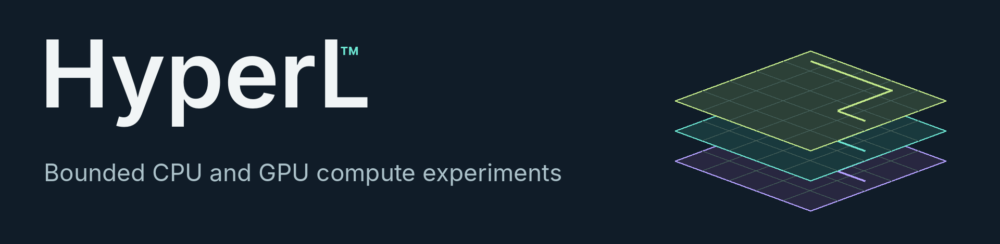
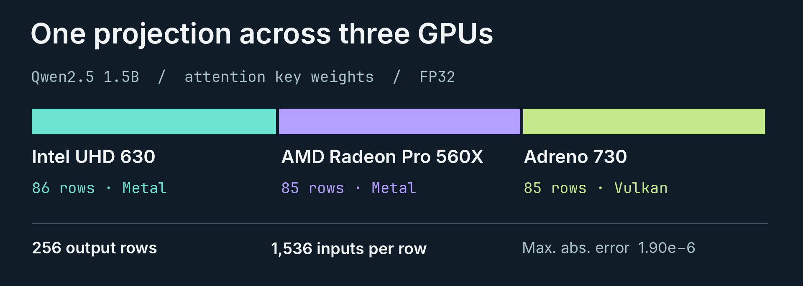

# HyperL™



HyperL runs bounded tensor workloads on native processors. The standalone Rust engine reads immutable SafeTensors weights through a read-only mapping, plans local work against a byte budget, and executes a dense projection on CPU or a selected wgpu adapter. An optional graph frontend lowers typed operations to StableHLO MLIR for compilation with XLA or IREE.

Desktop Studio bundles a native CPU inference server and a Qwen2.5 starter. Hosted builds execute a prompt after extraction on Linux, macOS and Windows. Android has a separate NativeActivity CPU diagnostic. [Packaging and device checks](docs/BUILD_AND_TEST.md)

[Native engine guide](docs/NATIVE_ENGINE.md) · [CUDA migration and accelerator support](docs/CUDA_MIGRATION.md) · [Build and test](docs/BUILD_AND_TEST.md)

## Build the native engine

```sh
cargo build --release --locked --manifest-path engine/Cargo.toml --features gpu
engine/target/release/hyperl-engine processors
cargo test --locked --manifest-path engine/Cargo.toml --features gpu
```

Omit `--features gpu` for a CPU-only binary. The Rust executable builds independently of Python, CMake and Java. The output directory follows Cargo's target directory setting. The older bounded C ABI builds separately with CMake.

### Run a projection

With a local, immutable SafeTensors file containing activation matrix `x` and weight matrix `w`, run a projection with the SHA-256 from the model publisher or your own verified import. The last positional argument names a new output file.

```sh
hyperl-engine plan model.safetensors "$MODEL_SHA256" x w 536870912 auto
hyperl-engine project model.safetensors "$MODEL_SHA256" x w 536870912 auto result.safetensors
```

The executable in these examples is the one built above. `project` computes `x @ w.T`. CPU weights can be F32, BF16, FP8 E4M3FN or E5M2. Packed signed INT4 uses two values per U8, low nibble first, and an explicit positive per-tensor scale supplied with `--int4-scale`. CPU accumulates in f32. An F32 GPU projection accepts the exact quoted `gpu:...` identifier printed by `processors` in place of `auto`. GPU inputs are uploaded and results copied back. [Engine contracts and examples](docs/NATIVE_ENGINE.md)

## Desktop Studio

Launch `python studio/hyperl_studio.py` with Python 3.9 or later and Tk. Studio finds the release engine in the checkout or in the extracted desktop bundle. Select an immutable SafeTensors file, paste its expected SHA-256, and enter the two matrix names. **Find processors** lists the native engine's adapters. **Preview plan** reports CPU workers and byte usage. **Run projection** writes the result to a new file. Studio remembers the processor selection and tensor budget on this computer.

## Storage and inference

```sh
hyperl-engine pack auto model.safetensors model.hlz 1073741824
hyperl-engine unpack model.hlz restored.safetensors 1073741824
```

HLZ1 supports Huffman, arithmetic range coding, rANS and raw blocks. Auto measures encoded size per block. Unpack checks the encoded and decoded digests before publishing a new file. Keep serving weights in their original mapped format and pack cold copies for storage or transfer.

The Rust projection is one transformer primitive. For token generation, use the existing pinned llama.cpp GGUF adapter or the JAX Llama decoder. The fleet service, storage planner, erasure recovery and model-profile receipts have their own contracts. [Model sharding and fleet](docs/MODEL_SHARDING_AND_FLEET.md) · [High-assurance baseline](docs/HIGH_ASSURANCE_BASELINE.md)

## Hardware results



Two GPUs in an Intel Mac and one GPU in an Android phone computed different rows of the same Qwen2.5 1.5B attention projection. The Intel UHD 630 handled 86 rows, the Radeon Pro 560X handled 85 and the Adreno 730 handled 85. Each row used 1,536 FP32 inputs. The maximum absolute error against the reference was 1.90 × 10⁻⁶. This experiment measured one projection. End-to-end token generation across these GPUs is still unverified. [Measurement record](docs/evidence/intel-amd-adreno-projection-2026-11-24.json)

## Development guides

- [Research index covering 721 manuscripts](docs/research/manuscripts.csv)
- [Build and validation](docs/BUILD_AND_TEST.md)
- [Matched numerical performance harness](benchmarks/run_benchmarks.py)
- [Existing Python and C program contract](docs/LANGUAGE_V1.md)

The former JVM workbench, Kotlin shard worker and Android JVM probe are available in project history. Existing users of those applications can use the [previous source tree](https://github.com/sabbirimon/HyperL/tree/5a784b8). The native CLI has its own commands and execution contract.

## Commercial licensing

New material uses the [HyperL Community and Enterprise License](LICENSE). Earlier grants and third-party licenses are recorded in the [license history](docs/LICENSE_HISTORY.md) and [notices](NOTICE).

For commercial licensing inquiries, including proposed royalty arrangements, contact the maintainer. Any payment terms require a separate written agreement. [Commercial terms and contact](docs/LICENSING.md)
