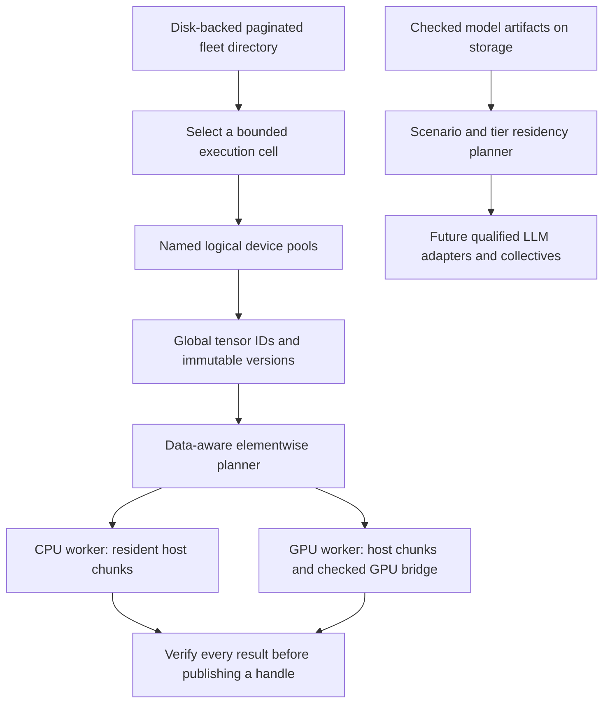

# Logical devices, model storage and fleet cells

Follow-up: [native LLM sharding and live bounded fleet operation](MODEL_SHARDING_AND_FLEET.md)
and [storage correction / high-assurance mapping](HIGH_ASSURANCE_BASELINE.md) now
extend this first increment. The small tensor API described here remains separate
from native model buffers. Physical TPU and million-device live qualification remain unrun.

Development increment: 2026-11-02. Standalone HyperL only; newly covered material
uses the Community/Enterprise licence. Existing `hyperl/1`, `hyperl-shard/1`,
native ABI, ordered reductions and historical hardware evidence are unchanged.

## What combines the devices

A `TensorRuntime` coordinates one **bounded execution cell** of explicitly approved
workers. Its default `combined` logical device contains all configured workers.
`defineDevice` creates additional named subsets. Pools may overlap; membership does
not create extra physical capacity. One pool can contain different CPU/GPU nodes,
provided each selected worker actually supports the admitted operation contract.



A logical device is a software placement target. Devices do not acquire a common
pointer space, uniform memory latency, pooled VRAM or magically interoperable SDKs.
GPU-worker resident chunks currently live in **worker host memory**. Each existing
checked bridge handles its GPU transfer/execution; persistent VRAM allocations are
not implemented. CUDA, TPU, NPU and model inference still need qualified adapters.

## Combine workers and execute

1. Build `./gradlew installDist`. Start each worker using private configuration,
   its own token, explicit backend and, for remote nodes, trusted TLS. Follow
   [Distributed execution](DISTRIBUTED_EXECUTION.md). No automatic enrollment,
   listener startup, binary download or public plaintext service is added.
2. List approved origins and private token-file paths in a copy of
   `examples/distributed-loopback.json`. This is the execution cell, currently
   **1–16 workers**; keep request/job/concurrency/memory limits explicit.
3. Run the new resident tensor path:

```sh
build/install/hyperl/bin/hyperl tensor-run /private/cluster.json examples/elementwise.json examples/inputs.json
```

The command returns one JSON object with the output tensor handle, checked result
and transfer counters. It clears its worker session before exiting where workers
remain reachable. It runs existing elementwise math, not an LLM.

Embedding Kotlin code can keep the session alive and chain work:

```kotlin
val runtime = TensorRuntime.connect(settings)
try {
    runtime.defineDevice("cpu-pool", setOf("a"))
    runtime.defineDevice("accelerator-pool", setOf("b"))
    val x = runtime.allocate(floatArrayOf(-1f, 2f, 3f), pool = "cpu-pool")
    val w = runtime.allocate(floatArrayOf(2f, 3f, 4f), pool = "accelerator-pool")
    val inputs = mapOf("x" to x, "w" to w)
    val plan = runtime.plan(program, inputs, pool = "accelerator-pool")
    val y = runtime.execute(program, inputs, pool = "accelerator-pool")
    val result = runtime.gather(y) // [0, 6, 12] for examples/elementwise.json
    runtime.release(x)
} finally {
    runtime.close()
}
```

Use the actual worker IDs and registered backends; a pool name does not turn a CPU
into a GPU. The default `combined` pool automatically stripes allocations across
members. Execution prefers the worker requiring the fewest missing input bytes,
then balances assigned elements among ties. Manual pool selection changes the
allowed targets. Missing chunks move through the coordinator and remain as worker
replicas; subsequent operations reuse them. Transfers are batched in up to eight
chunks. This is a bounded locality heuristic, independent of `shard-plan`'s richer
synthetic cost model; it does not implement adaptive fabric scheduling.

## Tensor and job contracts

- Handles contain a UUID, immutable version, shape and `f32` dtype. Row-major shapes
  have 1–8 positive dimensions, at most 262,144 total elements. Equal shapes are
  required; there is no broadcasting, matmul, attention or model executor.
- Supported worker operations remain `add`, `multiply`, `relu`. This path rejects
  reductions. The separate original `distributed-run` retains ordered terminal sum.
- `replace(old, values)` performs a compare-and-set against the latest version.
  Old snapshots remain readable until release. Stale replacements fail. Output
  handles publish only after all ranges pass CPU exact-bit or existing GPU-tolerance
  verification. Any sibling failure cancels local dispatch; no partial result or
  automatic retry is returned.
- `jobs()` exposes IDs, dependencies, status and committed output. `cancel(id)`
  cancels that transaction and attempts the existing authenticated remote stop.
  Remote cancellation acknowledgment is a request, not proof of kernel termination.
  `forgetJob(id)` removes a completed record; running records cannot be forgotten.
- One transaction runs per coordinator. Up to `maxParallelism` workers execute its
  shards concurrently. Coordinator limits: 256 live tensors, 4,096 partition records,
  256 job records, 64 pools; each tensor has at most 256 partitions. Release tensors
  and forget finished jobs explicitly. These ceilings are not measured fleet scale.
- New `hyperl-tensor/1` frames carry session/worker-instance/job identities, immutable
  slice versions and SHA-256 digests. The old shard envelope is unchanged. Worker
  resident data and active execution share application credits. Entry count, frame,
  metadata, batch, deadlines and queue limits remain bounded.
- Worker leases expire after five idle minutes and renew on chunk access. Session
  close attempts cleanup, including failed-transaction orphan chunks. Disconnected
  workers reclaim leases on expiry. The coordinator LRU is an optional, byte-bounded
  cache, not durable storage; a cached gather does not renew a remote lease. Callers
  must tolerate expiry instead of assuming indefinite residency.
- Each RPC reobserves capabilities and fences changed instance/backend/memory-domain
  identity; workers recheck admission. `connect(..., expectedInstances = mapOf(...))`
  can bind directory identities before allocation. This does not turn unsigned
  inventory metadata into identity proof; tokens/TLS remain required.

The tensor directory and job ledger are **in-memory**. Coordinator restart recovery,
checkpoint commit protocols, cross-cell tensor migration and tenant isolation remain
future work. No uncertain request is automatically replayed. Worker bearer tokens
represent one trusted owner, not a multi-tenant authorization system.

## Store large model files without loading them whole

`python/hyperl/model_storage.py` stores opaque checkpoint bytes as content-addressed
chunks with SQLite manifests. It does not deserialize models or execute pickle.
Import/export stream bounded chunks, verify chunk and whole-artifact SHA-256, check
quotas and cancellation, and publish manifests/output only after complete checks.
Repeated chunks deduplicate. Failed imports can leave reusable unreferenced blobs;
there is no automatic garbage collector. Hashes detect changes relative to the
manifest; separately trusted signed provenance is still required for authenticity.

```sh
PYTHONPATH=python python3 -m hyperl.cluster model-import /private/model-store /models/weights.safetensors 34359738368
PYTHONPATH=python python3 -m hyperl.cluster model-export /private/model-store ARTIFACT_UUID /private/restored.safetensors 34359738368
```

Choose actual paths and a quota. Each immutable artifact gets a distinct UUID; the
returned manifest reports bytes, chunk count and digest. Source files remain intact.
Default chunks are 4 MiB; the configurable range is 4 KiB–64 MiB. Artifacts have a
16 TiB logical-payload quota ceiling and at most ten million chunks. These bounds
are not multi-terabyte throughput evidence. Staging, manifests and filesystem
allocation need additional disk headroom. Store files are plaintext inside a
private owner-selected directory; existing [HLM2 encrypted datasets](DATASET_FORMAT.md)
remain a separate API. No automatic encrypted model staging is claimed.

`ModelChunkCache` provides an optional byte-bounded RAM LRU. Disk remains the source
of truth. Storage capacity is never added to executable RAM. A complete model file
can exceed the small tensor runtime's limits; storing it does not make that runtime
an LLM engine.

## Automatic scenario identification and manual tuning

Run a local, read-only placement estimate:

```sh
PYTHONPATH=python python3 -m hyperl.cluster model-plan examples/model-residency.json
```

The example is a **synthetic capacity/bandwidth fixture**, not measured GPUs or an
installed model backend. `execution_ready` and `reservations_guaranteed` are false.

The planner accepts exact layer byte sizes plus declared GPU/TPU/NPU/RAM/storage
tiers. `physical_domain` prevents counting aliased/unified memory twice. Select one
compatible declared model backend family per execution pool; incompatible TPU/GPU
stacks reject. Capacity and transfer bandwidth must come from real observations
before using a plan operationally; the planner itself does not discover devices,
reserve memory or activate any SDK.

Automatic scenario selection is explicit and explainable:

| Input | Scenario |
|---|---|
| `training: true` | training |
| At least eight concurrent requests | batch |
| Prompt of at least 4,096 tokens | prefill |
| Otherwise | interactive decode |

Every plan gets a process UUID and a reason. The defaults do not inspect arbitrary
OS processes, open ports or private prompts. Set `scenario` to override. Tune reserve
fraction, context/concurrency, activation workspace, training-state multiplier,
allowed host/storage offload, transfer budget and `manual` layer-to-tier assignments.
Training cannot select an inference-only memory policy. Storage offload defaults off.

For a gated decoder with grouped-query attention, supply `llm` instead of exact
`layers`, or use `LLMProfile` / `estimate_llm` in Python. The estimator derives packed
weights, group-scale overhead for 4/8-bit weights, KV for **prompt + generated tokens
and concurrency**, and activation workspace. `attention_workspace: dense` includes
the attention score matrix; a `linear` estimate requires explicit selection and a
suitable future fused backend. These are byte estimates, not precision/kernel support.
Other architectures, tensor layouts, quantization formats, biases and adapter
workspaces require exact checkpoint/backend measurements.

The residency heuristic places large/manual layers first, prefers execution memory,
and permits configured RAM or disk offload. KV, activations and estimated training
state consume execution memory; each offload target reserves the largest assigned
layer's staging buffer. Plans report tier use and weight-transfer bytes/time per
pass. Decoding can repeat those transfers for every token, so disk offload can be
very slow even when a model fits the storage quota. Inter-layer activation movement,
collectives, contention and end-to-end inference latency are **not** estimated.
Whole-layer placement can reject a layer too large for one device; tensor-parallel
splitting needs a qualified model runtime and communication contract.

## A million local or remote devices

`python/hyperl/fleet.py` supplies a disk-backed **inventory shard** with bounded
1,000-record enrollment batches/pages, persistent epoch fences, lease expiry,
revocation, indexed cell membership and named pools. `shard_for(id, count)` provides
stable SHA-256 routing for an explicitly configured directory shard count. Changing
that count requires a migration; there is no automatic distributed consensus.

Each cell selects a small approved worker set for the current 16-worker executor.
Many independent cells can run separately. A fleet-level scheduler, hierarchical
RPC service, gateways/NAT traversal, cross-cell jobs, failover/replication, durable
workflow engine and million live connections are **not implemented** by this
inventory. Run these as later Rust/C/C++ services after qualification; no Rust
compiler was available for this increment. Existing compute remains native C and
explicit checked GPU bridges, with Kotlin control and Python/native-SQLite storage.

`DeviceDirectory.enroll` is an owner operation; a greater epoch explicitly
reauthorizes a changed instance/endpoint. Ordinary same-epoch heartbeats cannot
undo revocation or replace identity. Remote origins require HTTPS; credentials
never belong in directory records. `resolve(id, epoch, now)` rechecks lease and
revocation before selecting a device. Directory pages are live observations, not
snapshot isolation or execution authorization. Expired/revoked records preserve
epoch fences; pruning requires an external authoritative ledger.

```sh
PYTHONPATH=python python3 -m hyperl.cluster fleet-enroll /private/fleet.sqlite /private/enrollment.json CURRENT_EPOCH_MS
PYTHONPATH=python python3 -m hyperl.cluster fleet-page /private/fleet.sqlite CURRENT_EPOCH_MS --cell cell-a --limit 16
python3 scripts/benchmark_fleet.py /private/new-synthetic-fleet.sqlite --devices 1000000
```

Enrollment JSON uses `format: hyperl-fleet-enrollment/1`, a `devices` list of `Device`
fields (`id`, `cell`, `architecture`, `endpoint`, `instance`, `epoch`, `expires_ms`)
and optional `pools` mapping names to cell lists. Heartbeats expire within five
minutes of caller-supplied current time. The CLI contacts no device. Directory
agents must authenticate incoming observations before calling these local APIs.

The 2026-11-02 local synthetic benchmark inserted **1,000,000 records** in 46.24 s
and paged all records in 16.16 s, with a 199,344,128-byte database and 23,355,392-byte
peak process RSS. It checked 16-node cell selection and expiry. It opened **zero
live device connections**. See [validation](VALIDATION.md) for test evidence and
unrun hardware/deployment gates.

A separate 256 MiB synthetic artifact check uses 64 chunks, verifies complete
import/export hashes and peaks at 30,044,160 bytes process RSS. Reproduce with
`python3 scripts/benchmark_model_storage.py /private/workdir --mib 256`. The temporary
source, store and export require disk headroom and are cleaned after the run.
