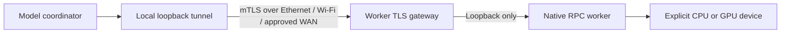
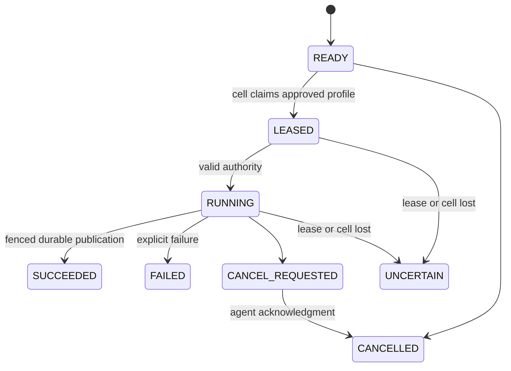

# Native LLM sharding, JAX execution and fleet scheduling

2026-11-02 development increment. This extends the earlier bounded tensor and
artifact work. The original `hyperl/1`, native CPU ABI and vector numerics remain
unchanged. These model adapters have separate execution and numerical contracts.

## What now executes

| Path | Working behavior | Evidence boundary |
|---|---|---|
| Native llama.cpp adapter | Loads an explicitly selected GGUF, tokenizes, owns KV, evaluates a complete pretrained model and generates text/tokens | SmolLM2 135M Q4_K_M exercised locally and split across two independent CPU workers |
| Native layer/KV sharding | Places different model layers and their KV allocations on configured RPC workers; sends actual native tensor/graph work | Both workers execute graphs; 16 greedy tokens match the local reference over direct RPC and mTLS routes |
| JAX f32 decoder | Dense gated/GQA/RMSNorm/RoPE attention and autoregressive generation with tensor-parallel weight and KV partitions | Four logical CPU devices match one CPU and an independent NumPy reference; physical TPU/GPU unrun |
| Fleet control plane | Durable pull queues, cell/profile selection, tenant turns, leases/epochs, cancellation, result fencing, warm model reuse and HMAC audit | Two actual authenticated pretrained-model jobs; one million synthetic queue records and 1,000 claim/start/finish cycles |
| Recovery | Verified token-boundary JAX KV/logits checkpoints; fail-closed native worker loss; native C storage-erasure correction | Checkpoint continuation/tamper tests, killed-worker rejection, independent erasure arithmetic tests and whole-artifact repair |

No million-device live deployment, formal high-assurance certification, physical
mixed-architecture model run, or TPU hardware execution was performed. The owner
selected adapter/tests without a TPU. A million-record queue test is distinct from
one million simultaneously connected devices. [Validation](VALIDATION.md).

## Build the optional native engine

The native engine remains an independently installed MIT component. HyperL calls
its public loopback interface; it does not copy a model engine into the existing
vector language or redistribute model files. [Pinned provenance](LLM_BACKEND_PROVENANCE.json).

Choose a reviewed **clean local checkout** of
[RunanywhereAI/llama.cpp at the exact tested revision](https://github.com/RunanywhereAI/llama.cpp/tree/4df29be4f4c3673f428170fda944a5b19f743bb8), then run:

```sh
python3 scripts/build_llm_runtime.py \
  --source /owner/source/llama.cpp \
  --output /owner/runtime/llama-rpc \
  --backend cpu --parallel 2
```

The script checks the source revision and tracked cleanliness, disables UI asset
build/download and network model loading, builds only selected targets, and writes
an executable/library hash manifest. It never clones source, installs drivers or
downloads weights. CPU is the default build target; `metal`, `cuda`, and `vulkan`
require an explicitly selected SDK/backend and separate hardware qualification.
No GPU build result is reported as GPU execution.

Copy [the profile example](../examples/llm-profile.json) outside source. Replace all
`/owner/` paths and zero SHA-256 placeholders using independently trusted artifacts
and the build manifest. Set `backend: CPU` and remove `rpc`/`proportions` for a local
model. `GPU` requires exact registered local device names; `RPC` selects one exact
exposed backend per approved route. The adapter rejects changed/missing devices.

```sh
PYTHONPATH=python python3 -m hyperl.cluster artifact-hash /owner/models/model.gguf
PYTHONPATH=python python3 -m hyperl.cluster llm-run /owner/profile.json /owner/prompt.txt --tokens 32
```

The profile pins the executable, model digest, source revision, context, deadline,
thread count, load mode and device proportions. Prompts and predicted tokens must
fit the reserved context; context shifting and auto-fit are disabled. Native HTTP
binds only to numeric loopback, uses a private per-session API key file, accepts
bounded responses and runs in offline mode. Keys and prompt-bearing native logs
are not returned in evidence; the log reader retains placement/counter metadata.
A process hash does not authenticate a maliciously replaced shared library: protect
and verify the complete installation manifest and dynamic-loader environment.

The qualified native numerical profile fixes f32 KV, greedy sampling, flash
attention **off** and weight repacking **off**. An initial 135M test with automatic
kernel choices diverged at token 16. Explicit conservative choices produced matching
generation and passed the full direct/TLS/fleet/failure fixture. This does not prove
bitwise equivalence for every model or architecture. Every model/backend combination
needs its own output/tolerance and lifecycle qualification before wider use.

A native session can be kept warm for repeated requests. Fleet agents reuse the
current profile's process and reevaluate each prompt with prompt caching disabled.
Profiles may change only through owner configuration. An uncertain GPU/RPC/TPU
failure quarantines the agent until owner restart/revalidation. Cancellation stops
the owned local process or checks JAX host boundaries; remote kernels can remain
uncertain. No partial result is published and no uncertain generation is replayed.

## Combine physical devices

Each model-execution cell contains a small approved device group. For the native
path, a model coordinator owns the GGUF/tokenizer and each worker owns distinct
native weight/KV buffers. The input embedding or other required host work can remain
at the coordinator. The two-worker evidence includes real layer assignments and
nonzero per-worker model/KV buffers, rather than separate full-model replicas.

1. On each worker, build the exact selected backend and configure
   [native-rpc-worker.json](../examples/native-rpc-worker.json) with the executable
   digest, exact `device`, CPU threads and local port.
2. Start `python -m hyperl.cluster rpc-worker /owner/worker.json`. Raw upstream RPC
   is experimental and binds to **127.0.0.1 only**. It is a trusted-owner native
   protocol, not a hardened multi-tenant sandbox.
3. For another host, wrap that local RPC endpoint using the configured mTLS route
   below. The model coordinator sees local loopback tunnel ports, one per worker.
4. Set the coordinator profile's `rpc` to those local ports and `proportions` to
   positive per-worker layer proportions, for example `[1,1]` or `[3,1]`.
5. Run `llm-run`, or assign the profile to a fleet cell. Startup refuses a plan
   unless every selected device is observed owning model layers.

The native adapter admits layer sharding only. Tensor-parallel f32 execution is
implemented separately in JAX. One logical pool does not create a common pointer
space, pool shared physical RAM twice, combine incompatible TPU/GPU SDKs, or make
cross-vendor collectives available. Use separate qualified native/JAX cells when
backend families cannot exchange the required model state.

### Wired, wireless and remote routes



| Route | How it connects | Appropriate starting use |
|---|---|---|
| Same host | Private loopback RPC | Reproducible process-level model sharding tests |
| Ethernet or direct cable | IP over configured LAN, plus mTLS | Layer sharding; tensor collectives only after latency/operator qualification |
| USB | An owner-provisioned IP/port tunnel, plus mTLS when crossing devices | Explicit mobile/edge route; USB presence does not create a model backend |
| Wi-Fi | Configured local IP routing and hostname-verified mTLS | Capacity-oriented layer splits after measuring jitter and loss |
| Remote LAN/VPN/WAN | Owner-provisioned reachable route and mTLS | Prefer independent request cells when per-token transfers are expensive |
| RDMA/fabric | Separately qualified driver/runtime/security adapter | Native build disables automatic RDMA negotiation; no fabric execution is qualified here |

Physical cabling and IP reachability are operator setup. HyperL does not change
firewalls, discover peers, install tunnels/drivers or solve carrier NAT. Wired and
wireless labels are not measured bandwidth. `LinkObservation` / `admit_link` use
fresh authenticated application bandwidth/RTT observations and explicit token
transfer budgets. Stale observations and expensive tensor collectives reject;
slow capacity-only placement requires explicit selection. These estimates exclude
kernel work and congestion and do not establish a latency guarantee.

Use [server route](../examples/rpc-tunnel-server.json) on the worker and
[client route](../examples/rpc-tunnel-client.json) on the coordinator:

```sh
PYTHONPATH=python python3 -m hyperl.cluster rpc-tunnel /owner/route.json
```

Replace example addresses with real configured interfaces. Provision private keys
outside source and issue certificates from the owner CA. Server certificates need
matching DNS/IP SANs. The native-route listener requires a client identity allowlist;
`cell:cell-a` is the example certificate CN. Connections are bounded, use 64 KiB
read/drain windows and idle deadlines, and never reconnect/replay automatically.
TLS protects the route; it does not make the upstream native decoder safe for
untrusted tenants. Use isolated hosts and a maintained ingress policy.

## JAX / TPU tensor parallelism

`jax_llm.py` requires an explicit backend (`cpu`, `gpu` or `tpu`) and exact device
IDs. A missing TPU backend raises an error; it cannot substitute a CPU. Device
meshes must divide query/KV heads, vocabulary and FFN size. Weight partitions and
KV-by-head ownership are observable through `residency()`; norms replicate and
XLA supplies required reductions. Dot products and attention explicitly request
`Precision.HIGHEST`; no implicit lower-precision matmul policy is selected. Returned evidence identifies actual device
platforms and process indices.

The implementation uses [JAX named sharding](https://docs.jax.dev/en/latest/jax.sharding.html)
and its public array/JIT interfaces. The local Intel-Mac test environment uses
JAX/JAXlib 0.4.38, with pinned dependencies in `requirements/jax-test.txt`. Do not
install that CPU test environment as an assumed production TPU driver stack.
Provision a compatible JAX/libtpu installation explicitly and qualify it on the
selected hardware. [JAX installation](https://docs.jax.dev/en/latest/installation.html).
Multi-controller JAX must be initialized by the owner before loading the decoder;
HyperL never starts a hidden distributed JAX service.

The checkpoint format is `hyperl-llama-f32/1`: a bounded `manifest.json` describing
`DecoderConfig`, exact tensor basenames and SHA-256 digests, plus contiguous f32
`.npy` arrays. Tensor names/shapes come from `DecoderConfig.shapes()`. Loading uses
read-only memory maps, rejects pickle/object arrays, validates every digest and
finite value, and admits weights/staging/KV before device placement. This contract
supports dense gated Llama-style GQA; MoE, biases, arbitrary HF imports, quantized
JAX weights and automatic precision conversion are unavailable.

[jax-tpu-profile.json](../examples/jax-tpu-profile.json) selects the TPU path.
`llm-run` reads a JSON list of model-specific token IDs for this adapter. Text
encoding/decoding belongs to the matching externally provisioned tokenizer; no
arbitrary tokenizer/model Python code is executed from checkpoint metadata.

### Token-boundary checkpoints

`save_checkpoint(new_directory, max_bytes=...)` writes verified model/config/backend
identity, KV prefixes, next-token logits and position, publishing the manifest last.
`restore_checkpoint(..., manifest_sha256=TRUSTED_DIGEST, max_bytes=...)` checks every
component before publishing state. `generate([], reset=False, ...)` continues from
that boundary. A restored same-backend session can use a different compatible
logical mesh; qualify its numerical results. Cross-backend restoration and
multi-controller checkpoint publication reject until separately qualified.

Checkpoint manifests and artifact hashes are integrity records, not a backup
service or signature authority. Store their trusted digests externally. Files are
plaintext inside a private directory; use operator-provisioned encrypted storage
or the separate HLM2 API where required. JAX cancellation checks host boundaries
and cannot promise immediate interruption of an accepted accelerator computation.

## Durable fleet operation

The fleet uses **pull scheduling**: devices are grouped into bounded model cells,
and each cell agent contacts its configured authority shard. The authority does
not hold one connection per inventory device. Directory shards route by stable
node identity; independent scheduler/ingress shards bound concurrent connections,
queues and execution cells. Changing the directory shard count needs an explicit
migration. There is no distributed consensus or automatic database replication.

The authority registers immutable model profile IDs with an expected artifact digest
and adapter. Agents compare that identity before loading, and success publication
checks the reported artifact. This prevents accidental profile mismatch, not
Byzantine execution or hardware-attestation fraud. Revoked profiles require a new
versioned ID. A `Cell` pins instance, epoch, pool membership, model profiles and slots. A restart
or changed profile requires owner enrollment at a higher epoch. Agent heartbeats
can renew existing evidence, not reauthorize a revoked cell. Jobs bind tenant,
idempotency key, immutable input digest, profile, lease, cell instance and epoch.
Pending queues are indexed on disk; tenant turns avoid one pending tenant owning
all scheduling turns. Native agents currently admit one warm session per cell;
parallel capacity comes from separate bounded cells.



Expired, revoked, changed-instance and late results cannot publish. Uncertain work
is not automatically requeued. Idempotent submission suppresses duplicate effects;
a changed request under an old key rejects. A lost result-publication acknowledgment
does not trigger another generation. Clock rollback blocks lease changes until
operator reconciliation. The ledger is durable SQLite/WAL, with transactional HMAC
state-transition audits and explicit queue/audit limits; disk durability still
depends on the selected filesystem, backups and failure domain.

Provision a private CA and certificates with CN `tenant:TENANT_ID` or `cell:CELL_ID`.
CA issuance is the role authority. Review certificate revocation/rotation and gateway
policy separately; this code does not implement a PKI service or CRL/OCSP refresh.
Use a separate CA/ingress boundary per deployment shard and protect its private key.

```sh
PYTHONPATH=python python3 -m hyperl.cluster audit-key-new /owner/keys/audit.key
PYTHONPATH=python python3 -m hyperl.cluster fleet-register /owner/fleet-service.json
PYTHONPATH=python python3 -m hyperl.cluster fleet-serve /owner/fleet-service.json
PYTHONPATH=python python3 -m hyperl.cluster fleet-agent /owner/fleet-agent.json
PYTHONPATH=python python3 -m hyperl.cluster fleet-submit /owner/fleet-client.json /owner/job.json
PYTHONPATH=python python3 -m hyperl.cluster fleet-status /owner/fleet-client.json JOB_UUID
PYTHONPATH=python python3 -m hyperl.cluster fleet-cancel /owner/fleet-client.json JOB_UUID
PYTHONPATH=python python3 -m hyperl.cluster audit-verify /owner/fleet-service.json
```

Start each long-running command in its own foreground terminal/service. Examples:
[service](../examples/fleet-service.json), [agent](../examples/fleet-agent.json),
[tenant client](../examples/fleet-client.json), [job](../examples/fleet-job.json).
These contain nonworking paths/zero digests/documentation addresses until explicitly
configured. The cell's native profile can contain several actual RPC shards, or a
JAX profile can select its own supported mesh. Incoming jobs contain bounded prompts
or token IDs and sampling limits, never executable paths, drivers or raw endpoints.

### Scale evidence and the next deployment gate

The synthetic authenticated-ledger run stores **1,000,000 jobs** using 1,000-record
batches and completes 1,000 claim/start/finish cycles with HMAC audit. It took
256.48 s to insert and 2.38 s for those transitions, with a 534,609,920-byte database
and 24,461,312-byte peak process RSS. These are one-host diagnostics, not a fleet
throughput guarantee. Separately, a live mTLS agent executed two real pretrained
model jobs. No million-device live test was conducted.

Actual million-device deployment requires many independently provisioned cells,
authority/ingress shards, authenticated enrollment, routing, monitoring, storage
replication, certificate lifecycle, overload tests and staged physical-host load
qualification. This implementation supplies a working bounded service/agent and
persistent primitives; configuration maxima do not qualify that deployment.

## Reproduce model and failure qualification

```sh
python3 scripts/qualify_llm.py \
  --server /owner/runtime/bin/llama-server \
  --worker /owner/runtime/bin/ggml-rpc-server \
  --model /owner/models/reviewed.gguf --model-sha256 ACTUAL_SHA256 \
  --output /owner/evidence/llm.json
XLA_FLAGS=--xla_force_host_platform_device_count=4 \
  python3 -m unittest discover -s scripts -p 'test_jax_llm.py' -v
python3 scripts/benchmark_scheduler.py /owner/new-synthetic-ledger.sqlite --jobs 1000000 --claims 1000
```

The fixture uses its own short-lived test CA and private temporary data, cleans
owned processes/routes, compares native reference/split tokens and text, verifies
model/KV placement, checks actual worker graph execution, runs live audited jobs,
and kills one worker during generation to require failure. It opens no public
listener and uses no cloud account. Evidence is narrow: one host, two CPU worker
processes, one small pretrained model, one seed/prompt and finite output length.
Broaden prompts/models/contexts/load/hardware before claiming general qualification.

[Storage repair and high-assurance control mapping](HIGH_ASSURANCE_BASELINE.md) ·
[Earlier logical tensors and model storage](LOGICAL_DEVICES_AND_MODEL_STORAGE.md).
