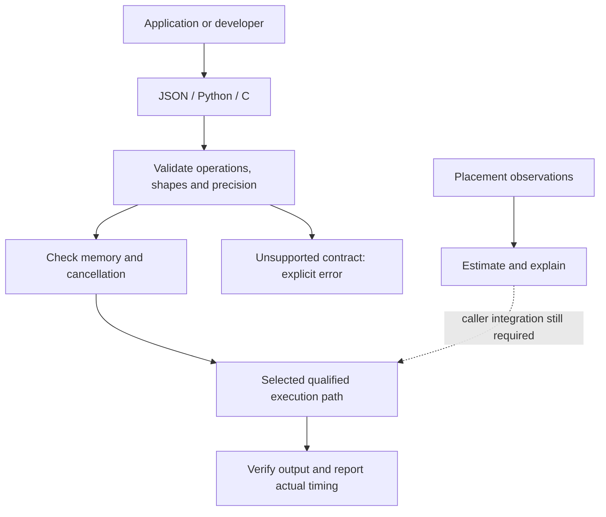
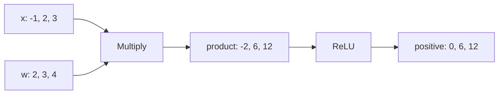
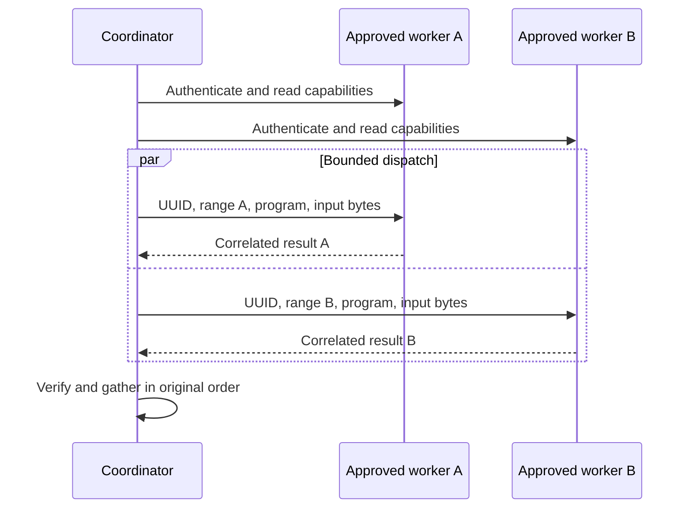
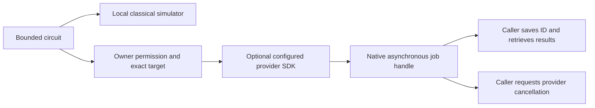

# Programming with HyperL

Updated 2026-10-24 for **alpha.6 development source**, `hyperl/1` and C ABI 1.
Published alpha.5 packages do not include all examples below. Start with the
[installation guide](USER_GUIDE.md); use the [documentation index](README.md) to
find platform and protocol details. This is standalone HyperL, independent of Meshlit.

## 1. Choose your programming interface

| Interface | Use it for | Current boundary |
|---|---|---|
| JSON + CLI/workbench | Small portable arithmetic graphs and diagnostics | Four finite-f32 operations; bounded vectors |
| Python + native C library | Embed recipes in an existing application | Explicit library loading; copying NumPy/Torch bridges |
| C ABI | Embed CPU execution without a JVM | Caller-owned buffers, status codes and cancellation |
| Distributed CLI | Execute bounded vector ranges on approved workers | CPU and optional checked OpenCL/Metal adapters |
| Kotlin library | Placement estimates, capability negotiation, signing/hashing | Separate APIs; estimates do not dispatch |
| Python quantum module | Local circuit simulation and optional provider bridges | Classical simulator; external SDK/QPU qualification separate |



## 2. Build and run the first program

From this repository checkout, with JDK 17+ (local qualification uses JDK 21):

```sh
./gradlew --no-daemon test installDist
build/install/hyperl/bin/hyperl capabilities
build/install/hyperl/bin/hyperl run examples/elementwise.json examples/inputs.json
```

Windows uses `gradlew.bat` and `build\install\hyperl\bin\hyperl.bat`.
The result contains `[0, 6, 12]`. In subsequent commands, `hyperl` means this
launcher or the equivalent launcher in your extracted distribution.

Save `preprocess.json`:

```json
{
  "format": "hyperl/1",
  "inputs": ["x", "w"],
  "instructions": [
    {"output": "product", "operation": "multiply", "inputs": ["x", "w"]},
    {"output": "positive", "operation": "relu", "inputs": ["product"]}
  ],
  "output": "positive"
}
```

Save `values.json`:

```json
{"x": [-1, 2, 3], "w": [2, 3, 4]}
```

```sh
hyperl validate preprocess.json
hyperl memory-plan preprocess.json values.json 16777216
hyperl diagnose preprocess.json values.json 16777216
hyperl run preprocess.json values.json 16777216
```

`validate` checks structure. `memory-plan` estimates retained arrays and admission.
`diagnose` also checks the supplied inputs and CPU result. `run` executes; a memory
budget is an application admission bound, not an OS process-memory guarantee.



### Language rules to remember

- `add`, `multiply`, `relu`, `sum`; input shapes must match for binary operations.
- Every instruction creates a new name. Refer only to inputs or earlier results.
- 1–8 inputs, 1–64 instructions, 1–262,144 elements per input vector.
- At most 1,048,576 retained float elements in the bounded reference graph.
- Finite f32 inputs/results only; no implicit broadcasting or dtype conversion.
- Graph `sum` preserves ordered f32 addition. `sum-precise` is a separate primitive
  using compensated binary64 accumulation followed by one finite-f32 rounding.

See [the language contract](LANGUAGE_V1.md) and [precision plan](PRECISION_AND_HPC_PLAN.md).
FP64 arrays, BF16, IEEE binary128 and arbitrary precision are future typed execution
contracts. Python quantum complex amplitudes do not add these types to `hyperl/1`.

## 3. Reuse recipes and the workbench

```sh
hyperl library
hyperl recipe weighted_relu
hyperl recipe-run weighted_relu values.json
hyperl workspace-new first.hyperl.json
hyperl workspace-validate first.hyperl.json
hyperl gui
```

`recipe` prints a workspace containing the program and example inputs. Twelve
recipes include affine, residual, dot, sum and squared-norm operations. These are
small preprocessing graphs, not complete neural-network layers or model loaders.
In the GUI, edit inputs, validate/analyze, run, inspect the result, then save the
workspace. Stop requests cancellation. Source emission is a separate action.

## 4. Embed from Python

Python 3.10+ is required. Build the native library first:

```sh
cmake -S . -B build/native -DCMAKE_BUILD_TYPE=Release
cmake --build build/native --config Release
```

Run the following from the repository root with `PYTHONPATH=python python3 demo.py`.
On PowerShell, set `$env:PYTHONPATH = "python"` before invoking Python.
Save it as `demo.py` outside tracked source, or adapt it in your application:

```python
from pathlib import Path
import sys
from hyperl import NativeCpu, Program, Step, f32, weighted_relu

relative = {
    "darwin": "build/native/libhyperl_cpu_runtime.dylib",
    "linux": "build/native/libhyperl_cpu_runtime.so",
    "win32": "build/native/Release/hyperl_cpu_runtime.dll",
}[sys.platform]
cpu = NativeCpu(Path(relative).resolve(), budget_bytes=16 * 1024 * 1024)
x, w = f32([-1, 2, 3]), f32([2, 3, 4])
print(list(weighted_relu(cpu, x, w)))  # [0.0, 6.0, 12.0]

program = Program(
    ("x", "w"),
    (Step("product", "multiply", ("x", "w")),
     Step("positive", "relu", ("product",))),
    "positive",
)
print(list(cpu.execute(program, {"x": x, "w": w})))
print(list(cpu.precise_sum(f32([100000000, 1, -100000000]))))  # [1.0]
```

The Windows DLL path above is for a multi-configuration generator; use the actual
build output for your generator. The loader checks runtime/ABI identity and never
searches for or downloads a binary. A separately qualified platform wheel can use
`NativeCpu.bundled()` explicitly. The source package contains no native binary.

For cooperative cancellation, pass `cancelled=stop_event.is_set` to `execute` or
the recipe, where `stop_event` is a `threading.Event` owned by your application.
Keep it false during work and set it from the control thread. Cancellation raises
an error; discard incomplete work. See [interop and ownership](LIBRARY_INTEROPERABILITY.md).

## 5. Embed from C/C++

The C ABI has no JVM dependency. This complete CPU example prints `0 6 12`:

```c
#include <stdio.h>
#include "hyperl.h"

int main(void) {
    const float x[] = {-1, 2, 3}, w[] = {2, 3, 4};
    const struct hl_vector inputs[] = {{x, 3}, {w, 3}};
    const struct hl_step steps[] = {
        {HL_MULTIPLY, 0, 1}, /* value index 2 */
        {HL_RELU, 2, 0}      /* value index 3; unary b unused */
    };
    float output[3];
    size_t length = 0;
    enum hl_status status = hl_execute(inputs, 2, steps, 2, 3,
        output, 3, &length, NULL, NULL);
    if (status != HL_OK || length != 3) return 1;
    printf("%g %g %g\n", output[0], output[1], output[2]);
    return 0;
}
```

After saving as `demo.c`, a Unix build can use:

```sh
cc -std=c99 -I native/include demo.c build/native/libhyperl_cpu.a -lm -o demo
./demo
```

Use the equivalent CMake/MSVC target on Windows. Inputs must remain valid and
immutable during the call. The caller owns output storage and cancellation context.
Check every status; incomplete output must be discarded. A C cancellation callback
must use properly synchronized state when another thread sets it.

## 6. CPU, GPU, TPU and NPU selection

| Device | How to program today | What still needs qualification |
|---|---|---|
| CPU | JSON/CLI, native C ABI, Python recipes, CPU workers | SIMD/native compiler expansion and each new architecture |
| AMD/Apple Metal GPU | Explicit local Metal bridge, supported elementwise graphs | Exact GPU/operator/driver evidence; model runtime |
| OpenCL GPU | Explicit bridge and selected device index | Runtime/driver/device; no implicit CPU fallback |
| NVIDIA CUDA / AMD HIP | Emit source using `CUDA` / `ROCM_HIP` | Native compile/launch and distributed adapters |
| Android Vulkan | Separate qualification runner | General app/cluster integration |
| TPU | Adapter roadmap, e.g. separately qualified compiler/runtime integration | No TPU executor or TPU CLI target is delivered |
| NPU | Provider-specific adapter roadmap | No generic NPU execution; CANN/QNN/Core ML/etc. need separate contracts |
| FPGA / ASIC | Capability description and approval constraints | Bitstream/firmware, host driver and workload qualification |

```sh
hyperl emit CUDA preprocess.json
hyperl metal-probe /absolute/reviewed/hyperl-metal
hyperl gpu-probe /absolute/reviewed/hyperl-opencl
```

Emission produces source only. A detected chip, advertised TOPS value or accepted
capability record does not establish that your program can execute there.
[Platform matrix](PLATFORMS.md) · [enterprise fabrics](ENTERPRISE_FABRICS.md).

## 7. Run across workers

Use [the distributed setup guide](DISTRIBUTED_EXECUTION.md#start-workers-explicitly)
to create private token files and start two workers from the supplied examples.
Tokens belong outside programs and source control. Then:

```sh
hyperl distributed-plan /absolute/private/cluster.json preprocess.json values.json
hyperl distributed-run /absolute/private/cluster.json preprocess.json values.json
```



Non-loopback workers require TLS. Results must match job, worker, range, shape,
backend and integrity rules. Memory is accounted by physical domain; storage is
not added to RAM. The implementation supports vector sharding and a constrained
ordered terminal sum; full LLM layer/tensor sharding is still an explicit milestone.

The separate estimator has a reproducible synthetic example:

```sh
hyperl shard-plan examples/sharding-request.json 50000
```

`50000` is the fixture observation time, not a live production clock. Its output
has `executionActivated=false`; it does not start workers or reserve memory.
Use fresh observations for real planning. The [physical phone/Mac test](ANDROID_CROSS_PLATFORM_PROBE.md)
verifies both CPUs contributed, but the small workload was slower than local execution.

## 8. Local quantum programming

No provider account, external SDK or native library is needed for this example:

```python
from hyperl.quantum import Circuit, Gate, simulate

bell = Circuit(2, (Gate("h", (0,)), Gate("cx", (0, 1))))
result = simulate(bell, shots=1000, seed=7)
print(result["counts"])
print(result["probabilities"])
assert set(result["counts"]) <= {"00", "11"}
assert sum(result["counts"].values()) == 1000
assert result["hardwareExecution"] is False
```

This is classical state-vector simulation using binary64 real/imaginary components.
It supports H/X/RX/RZ/CX, radians for rotations and terminal measurement of all qubits.
Counts use `q[n-1]...q[0]`, with q0 least significant. Limits: 16 qubits, 4,096 gates,
65,536 shots and 16,777,216 estimated amplitude-gate operations for the local simulator.
Sampling is seeded; elapsed time varies. Pass `cancelled=` for cooperative cancellation.

Optional SDK bridges exist for IBM, Google Engine, Azure IonQ and OriginQ. They require
explicit owner configuration and an unexpired `ProviderPermission` scoped to the
exact target and shot limit. The bridge tests use SDK doubles; no cloud/QPU execution
has been qualified. The permission object is application policy, not a security
sandbox against arbitrary code running in the same process.



See [quantum APIs and provider examples](QUANTUM_EXTENSION_PLAN.md) and
[OriginQ HTTPS and version requirements](ORIGINQ_ADAPTER.md). UUIDs correlate jobs;
they do not prevent duplicate billing. Reconcile uncertain submissions before retrying.

## 9. Encrypt data, hash and sign artifacts

```sh
hyperl keygen /absolute/private/dataset.key
hyperl data-import /data/source.bin /data/encrypted /absolute/private/dataset.key 104857600
hyperl data-export /data/encrypted /data/restored.bin /absolute/private/dataset.key 104857600
```

Use new destination paths. AES-256-GCM chunks and authenticated manifests protect
stored data. Dataset rekeying, SHA-256/384/512 file hashing and Ed25519 artifact
signatures are described in [cryptography](CRYPTOGRAPHY.md). Hashing detects changes
relative to a trusted digest; signatures additionally bind to an independently
trusted publisher key. Neither alone authorizes code execution.

[Post-quantum migration](CRYPTOGRAPHY_EVOLUTION_PLAN.md) is a provider qualification
plan. Quantum simulation does not implement post-quantum encryption/signatures.

## 10. General-purpose and special-purpose applications

General-purpose applications can choose recipes and approved workers per job.
Special-purpose deployments should pin the program hash, exact numeric contract,
approved adapter/device, quotas, expected inputs and output verification policy.
These are application integration choices, not a new `--profile` command.

Measure total time including input preparation, serialization, transfer, execution
and verification. Report throughput and accuracy with workload/device/driver identity.
Do not add CPU/GPU/NPU advertised compute rates or memory capacities together.
Keep latency, throughput, capacity, energy and precision goals explicit.

## 11. Debug, extend and continue

Start with [troubleshooting](TROUBLESHOOTING.md), then the
[build and validation runbook](BUILD_AND_TEST.md). The
[progress record](PROGRESS_2026_10_24.md) explains fixes and evidence; the
[agent backlog](AGENT_BACKLOG.md) records pending work and acceptance gates.
New operations require a versioned contract, shape/numeric/memory rules, CPU oracle,
backend-specific tests and honest unsupported results. New hardware requires an
actual adapter and measurement; adding an enum or source emitter is not sufficient.
