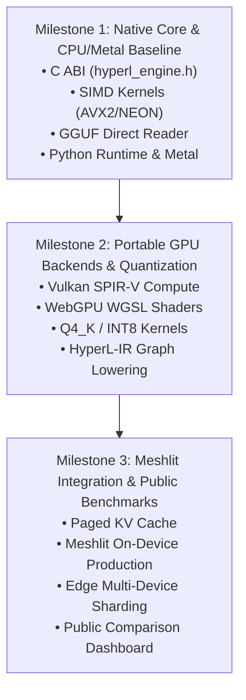

# HyperL 3-Milestone Engineering Roadmap

**Mission:** Build the leanest, memory-aware, cross-platform inference runtime for small-to-mid models (0.5B – 7B) on consumer hardware.

---

---

## Milestone 1: The Native Core & CPU/Metal Baseline (v0.2.0)
*Target: Ship a zero-dependency, ultra-fast native engine executing Qwen and Llama models on consumer CPUs and macOS Metal.*

- [x] **Stable C ABI (`hyperl_engine.h`)**: Pure C99 ABI with no JVM, Kotlin, or C++ standard library dependencies across the boundary.
- [x] **Essential SIMD Kernels**:
  - Cache-tiled GEMV (matrix-vector) with AVX2 and ARM NEON intrinsics.
  - Vectorized RMSNorm with reciprocal square-root accumulation.
  - RoPE (Rotary Position Embeddings) with precomputed trigonometric tables.
  - Numerically stable single-pass Softmax.
  - Multi-Head and Grouped-Query Attention (GQA) with contiguous KV cache.
  - Q4_0 block quantization and on-the-fly dequantization.
- [x] **Zero-Copy GGUF Model Import**: Direct mmap binary reader parsing GGUF v2/v3 metadata and tensors directly into memory without external server processes.
- [x] **Python First-Class Runtime**: High-level Python bindings (`python.hyperl.runtime`) interfacing directly with the compiled shared library via `ctypes`.
- [x] **Apple Silicon Metal Bridge**: Native Metal compute kernel support for unified-memory acceleration on M-series Macs.
- [x] **Cross-Platform CI**: GitHub Actions automated pipeline testing Ubuntu (x86_64), macOS (ARM64/NEON), and Windows (MSVC).

**Definition of Done:** Run a full autoregressive inference pass of Qwen 2.5 0.5B/1.5B or Llama 3.2 1B on CPU and Metal with verifiable logit equivalence and cold startup under 50ms.

---

## Milestone 2: Portable GPU Backends & Block Quantization (v0.3.0)
*Target: Expand GPU acceleration to Android, Windows, Linux, and browsers using modern graphics APIs while tightening memory footprint.*

- [ ] **Vulkan SPIR-V Compute Pipeline**:
  - Replace legacy OpenCL bridges with pure Vulkan 1.2 compute shaders.
  - Subgroup arithmetic for fast warp-level reductions in GEMV and Softmax.
  - Android NDK integration running models locally on mobile Adreno and Mali GPUs.
- [ ] **WebGPU (WGSL) Target**:
  - Standardized WGSL compute shaders for in-browser execution via WebAssembly + WebGPU.
  - Desktop execution via `wgpu-native` or Dawn.
- [ ] **Quantized Formats (Q4_K, Q8_0, INT8)**:
  - Implement k-quantization (Q4_K_M) with super-block scaling for higher fidelity at 4.5 bpw.
  - INT8 matrix multiplication using hardware integer dot-product instructions (`_mm256_maddubs_epi16`, NEON `vdotq_s32`).
- [ ] **HyperL-IR Compiler Passes**:
  - Memory liveness analysis assigning intermediate tensors to a fixed, pre-allocated scratch arena.
  - Operator fusion: `RMSNorm + GEMV` and `RoPE + Attention` to eliminate round-trip DRAM accesses.

**Definition of Done:** End-to-end execution of Q4_K quantized models on Vulkan (Linux/Android) and WebGPU (Browser) with peak RAM footprint strictly under 1.2x model size.

---

## Milestone 3: Meshlit On-Device Production, Public Benchmarks & Multi-Device Edge Sharding (v0.4.0)
*Target: Embed HyperL directly into Meshlit applications and establish verifiable public benchmark leadership.*

- [ ] **Direct Meshlit Integration**:
  - Drop-in embedded engine library for Meshlit desktop, mobile, and voice assistant bots.
  - Zero Python or CUDA dependency required for end users.
- [ ] **Paged Attention & KV Cache Memory Management**:
  - Dynamic block-based KV cache allocation to prevent memory fragmentation during multi-turn conversations.
  - Configurable context window sliding and prefix caching.
- [ ] **Public Benchmark Matrix**:
  - Publish reproducible automated benchmarks against `llama.cpp` and `ONNX Runtime`.
  - Metrics tracked: Time-To-First-Token (TTFT), Autoregressive Decode (tokens/sec), Peak Resident Memory (RSS), and Binary Footprint.
- [ ] **Consumer Edge Multi-Device Sharding**:
  - Partition small-to-mid models across two local consumer devices (e.g. laptop + phone) over local Wi-Fi with verified latency bounds.

**Definition of Done:** Meshlit ships with HyperL as its default on-device LLM engine; public benchmark reports are hosted on GitHub Pages with automated CI regression tracking.
