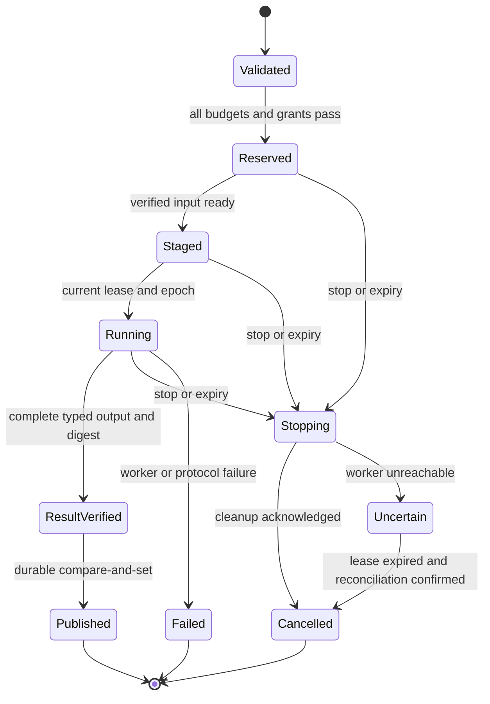

# Sharding and mixed-device execution contract

Proposed implementation contract, 2026-10-24 (Asia/Dhaka). The owner requires genuine
sharding, mixed processor architectures, load balancing, measured network lanes,
memory tiers and future adapter support. This document defines delivery gates beyond
the existing bounded vector executor; it does not establish physical multi-device
qualification or a full model engine.
The [heterogeneous plan](HETEROGENEOUS_EXECUTION_PLAN_2026-10-23.md) records vendor
tracks and [validation](VALIDATION.md) records actual evidence.

## 1. Baseline and success criteria

Current standalone code executes bounded f32 add/multiply/ReLU/ordered-sum graphs
on CPU, provides a C ABI preview, and has optional GPU hosts. Four bounded Metal
cases on Radeon Pro 560X and listed standalone Samsung Adreno 506 Vulkan cases have
separate hardware evidence. Alpha.6 also has a real authenticated
[split/map/gather executor](DISTRIBUTED_EXECUTION.md) for elementwise vectors, with
CPU/checked OpenCL/Metal worker adapters, bounded credits/frames/deadlines, replay
checks, cancellation and complete-result verification. Two independent JVM worker
processes and TLS trust/hostname tests were qualified on one Mac and in OS CI.
These are actual computations, not physical multi-device or mixed-GPU evidence.

Cluster-profile validation and the new H0 `shard-plan` estimator remain separate
from execution. Full tensor/model execution, physical mixed-device qualification,
OS/VRAM reservation, collectives and a durable production scheduler remain open.
Existing generated cross-language contracts, compensated CPU `precise-sum/1`, HLM2
authenticated datasets/key rotation and alpha.5 installers are preserved. Meshlit's
Android integration is separate. Newly covered orchestration follows the
[Community/Enterprise licence](LICENSE_HISTORY.md); no restricted implementation is
silently ported into Meshlit's Apache foundation.

The product target has three separately measured outcomes:

| Outcome | Acceptance evidence |
|---|---|
| Capacity | One model/workload is split across distinct devices and completes when its admitted working set cannot fit one chosen device; document the single-device limit and every shard's actual residency |
| Latency | End-to-end completion improves against the best applicable qualified single-device path, including staging, copies, queueing and synchronization |
| Throughput | Sustained completed work per second improves under a stated concurrency, error rate, latency percentile and power/thermal envelope |

Capacity gains can increase latency. Replicated complete models increase throughput
but do not demonstrate model sharding. Splitting input batches proves data sharding;
splitting layers, tensors or experts proves a separately named model-sharding mode.
No aggregate RAM/VRAM/FLOPS sum implies one coherent memory space or a speedup.

## 2. Dependency order and acceptance gates

| Gate | Deliverable | Required evidence before moving on |
|---|---|---|
| H0: bounded contract | Versioned capability, memory-domain, link and shard-plan objects; deterministic admission and estimates; no dispatcher | Invalid/stale/unapproved evidence fails closed; checked sizes; exact partition coverage; reproducible plans; estimates explicitly identified |
| H1: independent-host qualification and recovery | Extend the existing authenticated executor to independent physical CPU hosts; integrate reviewed plan admission and minimal durable attempt/epoch ledger | Physical two-host execution agrees with reference; neither worker executes all input; preserve current corrupt/replay/late-result rejection and cancellation, then prove restart, fencing and remote recovery |
| H2: heterogeneous workload | One separately qualified CPU/GPU combination, then ARM/x86 independent hosts; resource and bandwidth aware rebalance between jobs | Per-backend numerical conformance, real architecture/driver evidence, transfer-inclusive timing, thermal slowdown, worker loss and bounded buffers |
| H3: tensor/model foundation | Typed shape/stride/dtype IR or reviewed external engine boundary; bounded matmul/norm/attention/KV operations; one pinned dense model on one host | Tokenizer, weights, prompt format, intermediate tensors and generation checked against the model's reference engine; known memory/cancellation limits |
| H4: mandatory model sharding | One dense model with explicit layer/pipeline placement across two independent devices; KV/state ownership and checkpoints | Exact model/shard/weight hashes, actual residency and inter-stage activations; reference quality, prefill/decode, multi-request behavior, memory-limit case and failure/recovery test |
| H5: faster fabrics and collectives | Tensor/expert parallelism inside qualified compatible device groups; native collective adapters; encrypted transfer between groups | Collective order/dtype/timeout tests; topology-aware placement; real slow-link and bandwidth saturation evidence; equivalent outputs and measured cost |
| H6: operations and scale | Operational ledger/backup and multi-tenant services, one orchestrator adapter, optional cache, fair queues, telemetry and rollout | 3–5 independent hosts first, then measured 16/64/256-host steps; restart, partition, revoke, drain, backup/restore and tenant-isolation tests |

H0 is a complementary planning increment, not a prerequisite that erases the
existing executor. H1's physical-host and durable-recovery gates remain open.
H0/H1 work can proceed before all GPU and model import work. H4 remains a required
delivery gate; completing H1 or adding an external complete-model endpoint cannot
close it. Training and optimizer-state sharding follow inference qualification and
need additional autograd, collective and checkpoint tests. Each gate names actual
hardware dependencies rather than assuming access to every vendor's devices.

Every sharding run must attribute output contributions to at least two independent
device identities under one accepted plan. Claims of simultaneous mixed execution
also need an observed overlap interval with a stated clock/time-correlation method;
queued requests or two reported device names are insufficient. H1 needs a minimal
durable ledger for restart/fencing tests; H6 expands its operations and tenancy.

## 3. Current planning increment: H0

`HyperLShardingPlanner.kt` adds pure local admission and placement estimates.
`hyperl shard-plan REQUEST.json [OBSERVATION_TIME_MS]` reads supplied observations
without contacting workers or starting a listener. Its bounds are 2–262,144 elements,
at most eight candidate workers, sixteen physical memory domains and sixty-four
directed links; evidence expires after thirty seconds. It handles strict finite
f32 add/multiply/ReLU graphs and capacity/latency objectives. The optional time
argument supports reproducible fixtures; it does not renew actual observation age.
Actual checks for this source increment belong in [validation](VALIDATION.md).

This is a bounded heuristic, not a globally optimal scheduler. Per-worker linear
costs extrapolate measured program throughput to shard lengths; source ingress/
egress adds a conservative shared-bottleneck surcharge. It does not model arbitrary
downstream fabric topology, nonlinear kernel cost or true concurrent contention.
"No evaluated candidate fits" does not prove no possible allocation exists.
Result ranges and estimates are an explanation, not a signed dispatch manifest:
H1 must bind and revalidate selected backend/runtime/driver identities, data and
permissions before execution. `executionActivated=false`, `reservationGuaranteed=false`
and `timingsAreEstimates=true` remain explicit output fields.

Input contract and subsequent extensions:

- A validated program hash, input shape/count, f32 precision, requested objective
  (`capacity` or `latency`), deadline and maximum workers. Throughput objectives,
  richer minimum/maximum policy and explicit data-destination grants follow in H1.
- Worker device ID, target/runtime revision, exact program benchmark and supported
  operators, numerical contract, qualified/owner-enabled state and observation time.
  Actual enrollment, architecture/driver/kernel provenance and revocation binding
  remain executor-integration requirements. A supplied `qualified=true` alone is
  never enrollment proof; H0 fixtures must be labeled fixtures.
- Distinct physical memory-domain IDs and reservable bytes, allocation ownership,
  runtime/scratch/transfer overhead and existing reservations. Shared CPU/GPU UMA
  is one domain. Unknown capacity cannot become an unlimited budget.
- Measured operator throughput for the exact program/shape class and directed
  transfer goodput/RTT with measurement age, payload size and queue estimate. Missing
  observations permit an explicit insufficient-evidence outcome, never a zero-cost
  edge. Link line rate is not payload goodput.

First partition algorithm: nonempty contiguous f32 index ranges for independent
add/multiply/ReLU work, bounded by the current program/vector limits and at most
eight candidate workers. Require at least two distinct device identities for a
sharding candidate; processes on one host are local contract tests. Ranges cover
`[0, N)` exactly once with no overlap or omission. Reject ordered `sum` and other
cross-range dependencies in this estimator; reassociating a floating-point reduction
changes existing semantics. The existing executor separately supports one terminal
ordered f32 sum by gathering the complete vector at the coordinator with exact CPU
workers. Preserve that working contract; it is not distributed partial summation.

Use checked integer arithmetic for offsets, lengths and all byte estimates. Account
for all inputs, live intermediates, output, runtime/scratch and send/receive buffers
under each domain; estimate peak lifetime, not just model file size. Admission must
not subtract the same reservation twice or sum aliases of one physical domain.
An estimate is not an OS allocation guarantee; the worker reserves and rechecks at
dispatch. Reject a plan that cannot represent its full budget safely.

Candidate ranking uses estimated critical-path completion:

`queue + input staging + serialization/copies + link transfer + compute + output assembly`

Independent branches use the maximum branch completion plus shared bottlenecks,
not the sum of branch CPU time. Compare an unsplit candidate and show why a shard
plan was rejected, selected for capacity or expected to improve a stated metric.
Pin stable tie-breakers and input ordering so identical observations yield identical
plans. H0 output states `executionActivated=false`; all timings remain estimates.

H0 tests must cover zero/huge sizes, checked overflow, duplicate identities, stale
and future timestamps, NaN/infinite/zero rates, missing links, shared domains,
insufficient memory, incompatible precision/operators, cancelled owner permission,
slow links, capacity-only outcomes and exact full coverage. Test a plan change after
measured load changes. Benchmark fixtures do not count as hardware qualification.

## 4. Job, lease and publication protocol for H1 onward

The following is the durable recovery extension. Existing alpha.6 frames already
bind request/worker-instance/range/digest/backend, enforce bounded replay records,
credits and deadlines, and use explicit token-authenticated loopback or verified
TLS endpoints. It does not yet provide the durable epochs, tenancy and recovery
ledger below; keep those requirements distinct from existing safeguards.

Versioned control messages bind tenant/project, job ID, idempotency key, attempt,
coordinator epoch, plan digest, shard range, artifact/input hashes, adapter identity,
resource lease, deadline and allowed output destination. Credentials travel through
the transport/key provider, never through language JSON or model prompts.

Stages are persisted before externally visible transitions. A new coordinator epoch
fences stale writers. Result publication is a conditional ledger transaction over
job/attempt/epoch and output digest. Transport retries may duplicate delivery;
effects are not assumed exactly once. Only pure/idempotent shards are retried in the
first pilot. Stateful decoding resumes solely from a verified checkpoint binding
token position, RNG/sampling configuration, model/KV ownership and plan revision.

Workers reject replayed, expired, revoked or incompatible work before allocation;
late results from an obsolete attempt are discarded. A failure cancels dependent
shards, releases leases and removes uncommitted staging. Stop acknowledgments report
actual worker cleanup. Unreachable workers remain `uncertain` until lease expiry
and reconciliation; the UI cannot claim immediate remote termination. Lease timing
uses a bounded local monotonic duration; wall-clock skew cannot extend a lease.

Checkpoint movement never reallocates live KV or collective ranks in the middle of
a token/operation. Replanning creates a new attempt at a documented safe boundary.
Repeated failures lower eligibility and quarantine the adapter pending review;
precision changes and fallback destinations require a new admitted plan.

## 5. Load balancing and variable-speed data lanes

Start with one scheduler owner and one explicit source of resource reservations.
Placement filters capability, trust, data residency, quota and memory before ranking
time or cost. Within eligible devices, use recent measured service time and data
locality; retain session affinity for resident weights/KV. Bound per-tenant concurrency,
queue length and request age, and implement fair queueing with aging. Avoid piling
work onto a fast device already saturated by other tenants.

Network measurements include directed useful bytes/s, RTT p50/p95, jitter, loss or
retransmits when observable, in-flight bytes, queue delay, reconnect/error counters,
NIC/fabric and encryption mode, sample window and age. Unknown is shown explicitly.
Measure application payload time as well as link statistics; one-way delay requires
clock-synchronization evidence. Cost estimates include contested shared links and
the coordinator ingress/egress ceiling.

The existing transport uses maintained JDK HTTP/TLS with bounded frames and worker
credits. Extend it with separate control/cancel and bulk queues, resumable lanes
and richer measured flow control. Do not invent encryption or a new congestion-control
algorithm. A future lane negotiates maximum chunk bytes, in-flight credits, outstanding
requests, deadline, supported compression and integrity algorithm. Chunk sequence,
offset, byte length and digest bind to an immutable transfer manifest. Receivers
validate bounds before allocation and release credits only after consumption or
durable staging. Resume by verified chunk identity; authenticate completion before
publishing a file or tensor. Compression is optional and bounded after decompression.

Different lanes can progress at different speeds. Chunk size/window tuning uses
measured bandwidth-delay behavior within operator ceilings. Slow receivers cause
backpressure; they cannot grow queues without limit. Stop/control messages have
reserved capacity so a saturated dataset transfer cannot hide cancellation.
Do not require every device to synchronize on every chunk; synchronize at declared
DAG, token or collective boundaries. Avoid per-token WAN tensor splits unless an
actual capacity objective and measured cost justify them.

RDMA/UCX, NCCL/RCCL/HCCL and vendor interconnects are later adapters. They advertise
their exact topology, device memory access and security properties. A fast local
collective group can communicate with another vendor group through explicit typed
copies or a qualified bridge; there is no assumed cross-vendor collective ABI.

## 6. Memory tiers, storage and optional Redis-compatible cache

Model each physical domain with owner, addressability, lifetime, coherence and
capacity observations. Distinguish host DDR/LPDDR, accelerator HBM/GDDR, unified
memory, NUMA/CXL domains and SSD/NVMe/object storage. Remote RAM is an explicit data
service with transfer costs, not a local pointer. Bytes usable by storage are not
advertised as usable device RAM. Page migration, pinning and DMA require their own
host/backend support and privilege boundary.

Before activation, reserve weights, active tensors, KV/optimizer state where relevant,
scratch, compiler/runtime arenas, transfer buffers and checkpoint/staging peaks.
Preserve a configurable margin and handle fragmentation/allocation failure. Spill
is explicit and encrypted, quota bounded, cancellable and available only for operators
with a tested restore path. Report spill reads/writes/time and resulting latency.
Existing HLM2 dataset storage and authenticated rekey are local file facilities;
they do not yet implement automatic spill or distributed memory pooling.

An optional cache adapter can use Redis-compatible RESP for small immutable metadata,
capability snapshots, admission hints and content-addressed artifact locations. It
must declare the actual commands/transactions and server/version tested; RESP support
does not establish compatibility with every Redis feature. Pin the client/server
license and release before dependency adoption. [RESP specification](https://redis.io/docs/latest/develop/reference/protocol-spec/).

Keep the durable job ledger, stop epochs, ownership fencing, secrets and large tensor
payloads out of an evictable cache. Initial pilot uses a proven transactional ledger
and bounded local cache; Redis is optional. Namespace keys by tenant and compatibility
digest, enforce TLS/authentication/ACLs, TTL and byte quotas, and prevent cache-stampede
fanout. Cache miss/eviction/outage must preserve correctness and revocation. On failure,
re-read authoritative state or reject admission; cached grants never extend authority.

## 7. Framework, vendor and future protocol compatibility

Use separate extension interfaces for graph import, compute, memory, transport,
collectives, model serving and telemetry. Each descriptor declares schema/ABI range,
features, formats, bounds, allocator/stream ownership, cancellation, license/provenance
and conformance evidence. Mandatory unknown features fail; ignorable optional metadata
cannot affect execution. Maintain a deprecation window and fixtures for old versions.
No automatically downloaded plugin or model can activate executable code.

| Track | Proposed integration and qualification boundary |
|---|---|
| PyTorch/CUDA | Explicit native tensor/stream ownership and selected custom operations or reviewed model-engine adapter; record copies, autograd and collective scope. A CUDA source emitter does not import arbitrary CUDA programs. [PyTorch distributed interfaces](https://docs.pytorch.org/docs/stable/distributed.html) |
| TensorFlow/JAX/TPU | Supported graph/tensor export or selected runtime strategy; pin StableHLO/model/operator versions and actual host/device APIs. A TensorFlow distribution strategy is not proof that arbitrary mixed devices interoperate. [TensorFlow distribution](https://www.tensorflow.org/guide/distributed_training) |
| ONNX Runtime | Pin provider/runtime/model opset; inspect supported subgraphs and explicit fallback allocation. Test output and transfer ownership per provider. [Execution providers](https://onnxruntime.ai/docs/execution-providers/) |
| AMD/Intel/Apple/mobile | Separate ROCm/HIP/RCCL, oneAPI, Metal/Core ML, Vulkan/QNN/OEM tracks with per-device evidence; older chips remain eligible for supported subsets through qualified CPU or device adapters |
| Huawei Ascend | CANN/AscendCL compute, HCCL collectives and MindSpore graph/runtime tracks. HCCL provides Ascend communication over qualified links; it is not a generic protocol for every NPU. Ascend, Kirin/HiAI and other Huawei devices remain separate targets. [HCCL](https://github.com/cann-hccl/hccl/blob/master/README_en.md), [MindSpore parallelism](https://www.mindspore.cn/docs/en/r2.5.0/model_train/parallel/overview.html) |
| DeepSeek models | Record exact model/revision, MLA/MoE/quantization/KV requirements, router/expert placement and total weight residency. DeepSeek is a model/kernel ecosystem, not a processor architecture. Dense distilled models are a different qualification target. [DeepSeek-V3](https://github.com/deepseek-ai/DeepSeek-V3) |
| DeepSeek kernels | DeepEP and DeepGEMM are optional, separately pinned backend candidates with narrow hardware/runtime requirements. DeepEP's current upstream also links an Ascend implementation; qualify it independently. Never infer all-device support from a matching API. [DeepEP](https://github.com/deepseek-ai/DeepEP), [DeepGEMM](https://github.com/deepseek-ai/DeepGEMM) |
| Future hardware/protocols | Add an adapter and compatibility corpus without changing existing numerical meanings. Unknown device or firmware is discovered/unqualified until executable conformance and lifecycle tests pass |

References were inspected on 2026-10-24; moving upstream branches are research, not
dependency pins. Implementation records exact commits/releases, licenses and tested
devices before importing code. Networking protocols, tensor formats, kernel APIs and
model architectures have different compatibility boundaries and separate manifests.

## 8. Simple authoring and dynamic explanation

Use one typed SDK contract beneath a small Python-style facade and the CLI/GUI.
Start with named validated recipes and explicit array/tensor types; add graph/model
imports only as their format and operators become qualified. Avoid requiring users
to learn device driver APIs for supported work. Expert overrides still expose
precision, allowed devices, memory budget, data destinations and objective. Human
and agent clients use the same admission and revocation rules.

The explain-plan view should show a graph and accessible table: each stage/shard,
device and backend, input/output edges, physical memory reservation, transfer lane,
expected bottleneck, candidate alternatives and rejection reason. Distinguish
estimated, observed, stale and unavailable values in text as well as color. Live
events update status without changing the immutable accepted plan; a new placement
is a new plan/attempt. A simulation can visualize an unqualified device but cannot
be presented as live utilization or successful execution.

Begin with a bounded machine-readable explanation and CLI output. Build the visual
view from that same object after contract tests pass, keeping UI/event sampling out
of timed kernels. Version SDK interfaces, keep compatibility fixtures and document
deprecation. Future model formats and NPU providers plug into explicit capability
contracts, not arbitrary code supplied through prompts or model metadata.

## 9. Numerical and complex-mathematics roadmap

Preserve finite f32 intermediate rejection and ordered reductions in `hyperl/1`.
The existing separate `precise-sum/1` helper uses compensated binary64 intermediates
and one finite f32 result in C/Python/JVM; preserve its explicit CPU-only semantics.
It is not exact real arithmetic or a new graph opcode. Generated language bounds
and cross-language conformance already exist and remain the source of truth.
New operations specify input/output dtype, accumulation dtype, overflow/underflow,
rounding, subnormal/NaN/Inf policy, shape/stride/aliasing rules, determinism and error
bounds. An adapter must report the contract it actually implements. Relaxed math,
mixed precision and parallel reduction require explicit opt-in semantics and cannot
silently change results of an existing program.

Extend in order: shaped elementwise/broadcast operations and deterministic reduction;
matrix multiplication and normalization; validated attention/model primitives;
then selected complex-number types and operations, FFT or scientific-library
providers when workloads require them. Complex types specify real/imaginary layout,
precision, conjugation and branch-cut behavior. Reuse reviewed BLAS/FFT/math libraries
where appropriate; each imported operation retains upstream version/license and
numerical evidence. None of these new kernels is made available by this plan.

Conformance combines small exact cases, boundary/ill-conditioned inputs, independent
reference comparisons, metamorphic checks, repeated runs and cross-backend tests.
Record absolute/relative/ULP tolerances and the reason for them. Test dimensions and
address calculations for overflow before native allocation. Performance comparisons
must use equivalent precision and error constraints; a less accurate result is not
an unqualified speed improvement.

## 10. Security and cryptography boundaries

Distinguish three capabilities: artifact authenticity/integrity, protected cluster
transport/control, and explicit cryptographic workloads. Initial artifact signing
can use standard Ed25519 and SHA-256 through maintained providers with external keys.
Signature verification binds exact bytes/manifest identity to an owner-approved
public key. It does not prove code safety, artifact freshness, worker identity or
authorization to run. Unknown keys and malformed signatures fail closed.

Existing remote workers require configured verified TLS outside numeric loopback,
per-worker tokens and bounded replay checks. Extend this with pinned or enterprise
identities, scoped short-lived authority, durable attempt/epoch checks, rotation and
revocation. Bind artifact/model/input/output hashes and protocol version to each
authorized job. Keys remain in OS keystores/KMS/HSM or externally selected key files,
outside language JSON, prompts, logs and tensor payloads. Rotation retains verified
historical provenance while immediately refusing revoked authority for new work.
Enforce tenant data separation, native sandbox/resource ceilings and explicit
destinations regardless of the requesting LLM or agent.

Cryptographic workload APIs, if later needed, should call established audited
providers for encryption, signing, hashing or key agreement. They require byte/
integer types and side-channel/error/nonce/key-usage contracts; f32 vector kernels
are not cryptographic primitives. Future algorithm negotiation uses an allowlist,
versioned suites and downgrade rejection. Post-quantum or regional suites remain
separate research/qualification tracks until a maintained provider and tests exist.
Do not implement bespoke cryptography or weaken network isolation to accommodate
an unqualified adapter. Record whether native-provider FIPS or other certification
is actually present; a standard algorithm alone is not certification.

## 11. Measurement, failure and release record

Each accepted run stores a bounded redacted evidence bundle: source/program/model/
tokenizer/adapter hashes; device/OS/driver/runtime and topology; admission and actual
peak RAM/VRAM/staging; shard residency; precision/tolerance; correctness comparison;
queue/stage/transfer/compute/sync/publication time; useful bytes; throughput and p50/
p95/p99 with sample count/window; cancellation/recovery outcomes; power/thermal data
when observable. Missing measurements remain null. Preserve failing runs alongside
passing ones; never convert unknown counters into zero.

Small sample sets show individual samples/median rather than pretending to establish
tail percentiles. Compare cold and warm start, short and long work, single-user and
sustained concurrency, large/small payloads, throttled devices and constrained links.
State the exact workload and baseline for every performance claim. Test coordinator
restart, worker death, duplicate/late messages, corrupt/truncated chunks, stale grants,
epoch rollback, network partition, exhausted memory/disk, exporter/cache outage and
interrupted upgrades. Native memory/ownership boundaries also need sanitizer/fuzz
coverage and device-specific cleanup tests.

Before each wider rollout, report observed node count, duration, workload, failures,
resource ceilings and rollback path. Configuration maxima and synthetic inventories
remain labeled as such. No universal-chip, full-model, production-scale or ultra-fast
claim is accepted until its corresponding execution evidence exists.
