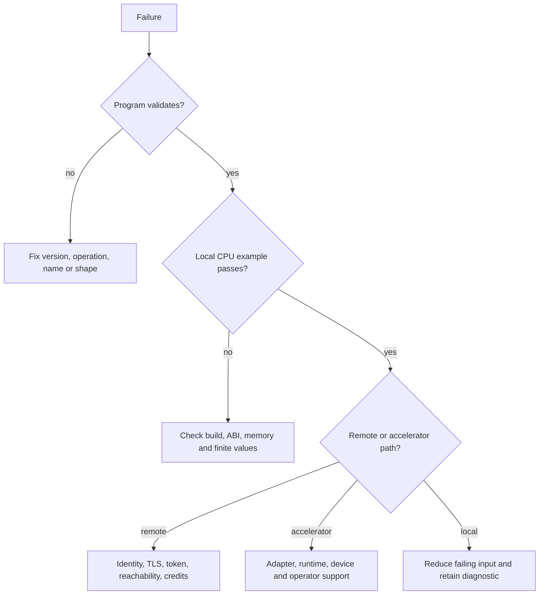

# Troubleshooting and debugging HyperL

Updated 2026-10-24. Match diagnostics to your exact commit/release. Alpha.5 binaries
do not include all alpha.6 commands. [Programming guide](PROGRAMMING_GUIDE.md) ·
[build runbook](BUILD_AND_TEST.md) · [validation evidence](VALIDATION.md).

## Start with the smallest reproducible case

```sh
git rev-parse HEAD
java -version
python3 --version
cmake --version
build/install/hyperl/bin/hyperl capabilities
build/install/hyperl/bin/hyperl validate examples/elementwise.json
build/install/hyperl/bin/hyperl diagnose examples/elementwise.json examples/inputs.json
build/install/hyperl/bin/hyperl run examples/elementwise.json examples/inputs.json
```

Expected arithmetic is `[0,6,12]`. Record the exact failing command, exit status,
OS/process architecture and first actionable error. Redact tokens, key material,
private inputs, account identifiers and private network addresses before sharing.
Do not upload whole environment dumps or provider credential/configuration files.



## Build and installation

| Symptom | Check / remedy |
|---|---|
| Unsupported Java version | Select maintained JDK 17+; local runs use 21. Recheck `java -version` in the build shell |
| Gradle cannot resolve artifacts | First build needs dependency access; offline mode only works with a populated cache. Retain the first dependency error |
| `Unknown command` | Run `hyperl help`; check which installed launcher you invoked and rebuild the intended source |
| GUI fails on server | Use CLI/native embedding without a display; GUI needs a graphical desktop |
| Low disk space | Check available space before packaging; retain source/keys/data. Inspect generated outputs before choosing any cleanup |
| Native DLL/library missing | Build the shared target and use its actual absolute path; match the Python process architecture |
| Native ABI/runtime rejected | Rebuild library and Python package from the same revision; do not bypass version validation |
| Missing NumPy/Torch/provider module | Optional dependencies are explicit. Core JSON/native arithmetic and stdlib quantum do not install them |

Use `./gradlew test --stacktrace` for local debugging. Keep stack traces private
until checked for paths or secrets. The CLI's normal bounded error is intentional;
there is no general HyperL `--debug` switch or source-level debugger yet.

## CPU, precision and memory

| Symptom | Meaning / next step |
|---|---|
| Inputs differ in length | Binary operations have no implicit broadcasting; fix the data shape |
| Nonfinite input/result | NaN, Infinity or f32 overflow is rejected. Inspect intermediate ranges |
| Sum differs from another framework | Check reduction order, dtype and fused arithmetic; graph sum is ordered f32 |
| Need a more stable sum | Try separate `sum-precise`; its final output is still f32 |
| Memory admission rejected | Inspect `memory-plan`, input sizes and retained intermediates; reduce workload or explicitly configure a justified budget |
| CPU architecture detected but backend fails | Process architecture, ABI and compiled library must agree; detection alone is not execution qualification |

FP64/BF16/binary128/arbitrary-precision arrays are not silently available. See the
[precision roadmap](PRECISION_AND_HPC_PLAN.md); splitting a job does not improve
its arithmetic precision. A memory estimate is not a hard RSS or VRAM reservation.

## GPU, TPU, NPU, FPGA and ASIC

1. Confirm the requested operation is implemented by the selected adapter.
2. Run the explicit bridge probe and record device/runtime/driver identity.
3. Run the smallest supported graph and compare against the CPU reference.
4. Separate source generation, compilation, launch, transfer and verification failures.

CUDA/HIP source output is not evidence of a working CUDA/HIP host runtime. TPU and
NPU execution adapters are not delivered in this increment; a missing adapter is
not fixed by changing a profile label. CANN/QNN/Core ML/TPU runtimes need their own
version/operator/precision/hardware checks. FPGA/ASIC negotiation similarly requires
approved firmware/configuration and a real driver path. Never substitute CPU while
reporting that an unavailable accelerator executed. See [platforms](PLATFORMS.md).

## Workers, networks and TLS

| Symptom | Check / remedy |
|---|---|
| Connection refused / timeout | Worker process/listener, configured origin, route and firewall; prefer a small explicit approved connection test |
| Authentication rejected | Both sides must use the intended private token file; do not print the token |
| TLS trust / hostname error | Correct CA/trust configuration and certificate hostname/SAN; do not disable verification |
| Busy worker / admission rejection | Outstanding jobs, per-worker credits, memory headroom and request timeout; avoid unbounded retries |
| Stale instance / replay / digest error | Refresh worker identity and start a new logical request; retain the failed record and investigate mismatched data |
| Output verification failed | Treat output as invalid; preserve redacted job/range/backend details and compare the same input locally |
| Planner says execution false | `shard-plan` estimates only; use separately configured `distributed-run` for execution |
| Distributed run is slower | Transfers, serialization and verification can dominate small kernels; compare complete latency with local execution |

An inventory profile or signed artifact does not enroll/authorize a worker. Non-loopback
workers require TLS. A terminal ordered reduction cannot use approximate GPU shards.
The [distributed guide](DISTRIBUTED_EXECUTION.md) defines timeout and cancellation scope.

## Android cross-platform probe

Use the [exact harness and setup](ANDROID_CROSS_PLATFORM_PROBE.md). The probe is a
standalone qualification app, not Meshlit. Missing setup means configure a new host
session; reused UUIDs must not run again. Reports are stored by session UUID so a
later local test cannot overwrite split evidence. Wired qualification requires an
observed USB ADB route; Wi-Fi qualification requires the app's observed bound Wi-Fi
network. A display saying Passed does not replace host correlation and output hashes.

## Quantum SDKs

- First run the stdlib Bell example in the programming guide. It requires no SDK.
- Remote permission defaults to off; match provider, target, expiry and shot count.
- SDK API changes need adapter qualification; OriginQ currently pins 0.4.0.
- OriginQ requires explicit HTTPS configuration; its documented HTTP default is rejected.
- Google Engine requires approved access plus actual device placement/gateset checks.
- Azure IonQ JSON is the supported Azure path; arbitrary QIR is not accepted here.
- An ambiguous submission may already have created a job. Save/reconcile provider job
  identity before retrying. A UUID is correlation metadata, not duplicate-payment prevention.
- Cancel accepted jobs through the provider's native job API. Expiring local permission
  does not cancel a job already accepted remotely.

Only simulator and SDK-double contract tests are recorded; SDK-native/cloud/QPU
qualification remains pending. Preserve native provider histogram semantics.

## Hashing, signatures and encrypted datasets

Wrong key/context/hash, damaged authentication tags, invalid format, quota overflow
or an existing output path should fail. Keep the original and use a new destination;
do not suppress integrity checks. Signature verification requires an independently
trusted public key and exact artifact ID/context. SHA-384/512 cannot be substituted
inside the fixed HLAS v1 SHA-256 signature format. See [crypto API](CRYPTOGRAPHY.md).

## Reporting and regression workflow

Include a minimal non-sensitive program/input, exact revision, platform, relevant
runtime/driver versions, expected versus observed behavior and reproducible steps.
Add a focused regression reproducing the defect, fix the owning layer, rerun that
test plus affected contract checks, and record the result in
[progress](PROGRESS_2026_10_24.md). Keep unrun targets explicit. General profiling,
semantic IDE debugging and production distributed tracing remain backlog items.
